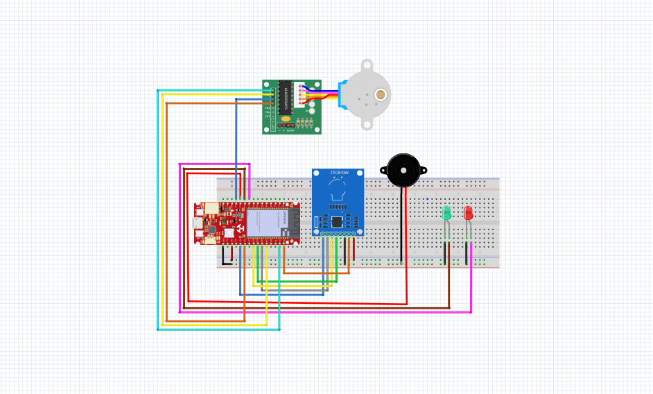
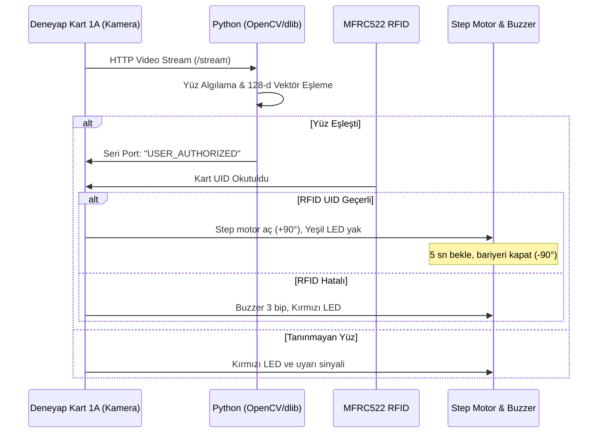

# 📷 Yüz Tanıma & RFID Tabanlı Akıllı Geçiş Kontrol Sistemi

[](https://deneyapkart.org)
[](https://python.org)
[](https://opencv.org)
[](#-lisans)

> **Deneyap Kart 1A (ESP32-CAM)** ve **Python dlib / OpenCV** modelleri kullanılarak geliştirilmiş, çift faktörlü doğrulamaya sahip (Yüz Tanıma + RFID Kart) akıllı kapı ve turnike otomasyonu.

---

## 📑 İçindekiler

1. [Projeye Genel Bakış](#-projeye-genel-bakış)
2. [Donanım Bileşenleri](#-donanım-bileşenleri)
3. [Devre Bağlantı Şeması & Pin Haritası](#-devre-bağlantı-şeması--pin-haritası)
4. [Yazılım Mimarisi & Çalışma Akışı](#-yazılım-mimarisi--çalışma-akışı)
5. [Kurulum ve Çalıştırma Adımları](#-kurulum-ve-çalıştırma-adımları)
6. [Yeni Kullanıcı Ekleme](#-yeni-kullanıcı-ekleme)
7. [Geliştirici](#-geliştirici)
8. [Lisans](#-lisans)

---

## 🌟 Projeye Genel Bakış

Bu proje, yüksek güvenlik gerektiren alanlar için tasarlanmış **iki aşamalı biyometrik ve fiziksel kimlik doğrulama sistemidir**:

1. **Görsel Doğrulama (ESP32 IP Kamera + Python):** Deneyap Kart 1A'nın dahili OV2640 kamerası ağ üzerinden video akışı sağlar. Bilgisayarda koşan Python betiği (dlib / face_recognition) gelen yüzü veritabanındaki kayıtlı yüzlerle karşılaştırır.
2. **Fiziksel Doğrulama (RFID RC522):** Kart okuyucuya yetkili kart okutulduğunda seri haberleşmeyle yüz doğrulama verisiyle eşleştirilir.
3. **Mekanik Eylem (Step Motor Turnike):** Her iki aşama da başarıyla doğrulanırsa step motor turnikeyi belirlenen açıda açar, yeşil LED yanar. Başarısız durumlarda buzzer alarm verir.

---

## 🧰 Donanım Bileşenleri

| Bileşen | Model / Açıklama | Görev |
| :--- | :--- | :--- |
| **Ana Kart** | Deneyap Kart 1A (ESP32 Dahili) | Wi-Fi IP video yayını ve I/O kontrolü |
| **Kamera** | OV2640 Kamera Modülü | 1600x1200'e kadar canlı görüntü akışı |
| **Kart Okuyucu** | MFRC522 RFID Modülü | 13.56 MHz RFID kart UID doğrulama |
| **Motor & Sürücü**| 28BYJ-48 Step Motor + ULN2003 | Geçiş kapısını / bariyeri çevirme |
| **Güç Kaynağı** | 5V 2A Harici Pil / Güç Modülü | Step motor akım dalgalanmasını önleme |
| **Geri Bildirim** | 2x LED (Kırmızı / Yeşil) + Buzzer | Görsel ve işitsel durum geri bildirimi |

> ⚠️ **Önemli Güç Notu:** Step motor ani tork anında yüksek akım çeker. Deneyap Kart'ın 3.3V/5V pinlerinden doğrudan beslemek kartın reset atmasına yol açabilir. Bu nedenle **step motor harici 5V pil ile beslenmeli ve GND hattı Deneyap Kart ile ortak (Common GND) bağlanmalıdır.**

---

## 🔌 Devre Bağlantı Şeması & Pin Haritası

<p align="center">
  
</p>

> 💡 **Devre Şeması Açıklaması:** Breadboard üzerinde **Deneyap Kart 1A**, **MFRC522 RFID Okuyucu**, durum bildirim LED'leri (D14 Yeşil & D15 Kırmızı), aktif buzzer (D13) ve harici 5V güçle çalışan **ULN2003 sürücülü 28BYJ-48 Step Motor (D1, D4, D12, D9)** bağlantıları yapılmıştır.

```
+--------------------------+              +----------------------------------+
|     Deneyap Kart 1A      |              |          Modül / Sensör          |
|                          |              |                                  |
|  D10 (SS / SDA)          |<------------>| RFID RC522 (SDA Pini)            |
|  D0  (RST)               |<------------>| RFID RC522 (RST Pini)            |
|  D8  (SCK)               |<------------>| RFID RC522 (SCK Pini)             |
|  D6  (MOSI)              |<------------>| RFID RC522 (MOSI Pini)           |
|  D7  (MISO)              |<------------>| RFID RC522 (MISO Pini)           |
|  3.3V                    |------------->| RFID RC522 (3.3V Güç)            |
|  D1                      |------------->| ULN2003 Sürücü (IN1 - MOTOR_1)   |
|  D4                      |------------->| ULN2003 Sürücü (IN2 - MOTOR_2)   |
|  D12                     |------------->| ULN2003 Sürücü (IN3 - MOTOR_3)   |
|  D9                      |------------->| ULN2003 Sürücü (IN4 - MOTOR_4)   |
|  D14                     |------------->| Yeşil LED (Başarılı Geçiş)       |
|  D15                     |------------->| Kırmızı LED (Hata / Yetkisiz)    |
|  D13                     |------------->| Aktif Buzzer (Sesli Uyarı)       |
|  GND                     |<------------>| Ortak GND (Kart + Motor + Sensör)|
+--------------------------+              +----------------------------------+
```

---

## 💻 Yazılım Mimarisi & Çalışma Akışı



---

## 🚀 Kurulum ve Çalıştırma Adımları

### 1. Python Gereksinimleri

Python 3.10 ortamında gerekli kütüphaneleri yükleyin:

```bash
# Gerekli temel paketler
pip install opencv-python pyserial numpy face_recognition

# Windows kullanıcıları için dlib derleme sorunu yaşamamak adına hazır .whl kurulumu:
pip install dlib-19.22.99-cp310-cp310-win_amd64.whl
```

### 2. Gömülü Yazılım (Arduino IDE / Deneyap IDE)

1. Arduino IDE'ye **Deneyap Kartlar** paketini ekleyin.
2. `kamera.ino` dosyasını açıp Wi-Fi bilgilerinizi girin:
   ```cpp
   const char* ssid = "WIFI_ADINIZ";
   const char* password = "WIFI_SIFRENIZ";
   ```
3. Kodu Deneyap Kart 1A'ya yükleyin. Seri Port Monitöründen IP adresini not edin:
   ```
   Kamera IP: http://192.168.1.45/stream
   ```
4. `rfid_led_buzzer_step.ino` kodundaki izin verilen RFID UID listesini kendi kartınızla güncelleyin:
   ```cpp
   String yetkiliKart = "B696C1F";
   ```

### 3. Yüz Tanıma Betiğini Başlatma

1. Tanınmasını istediğiniz kişinin vesikalık/net fotoğrafını (`kevser.jpg`) proje klasörüne koyun.
2. `tanima.py` dosyasında kamera URL'sini güncelleyin:
   ```python
   url = "http://192.168.1.45/stream"
   ```
3. Betiği çalıştırın:
   ```bash
   python tanima.py
   ```

---

## 👥 Yeni Kullanıcı Ekleme

Yeni bir personel veya öğrenci kaydetmek için `tanima.py` içerisindeki listeye ekleme yapın:

```python
# Yeni kişi fotoğrafını yükleyin
yeni_kisi_img = face_recognition.load_image_file("yeni_kisi.jpg")
yeni_kisi_encoding = face_recognition.face_encodings(yeni_kisi_img)[0]

# Listelere dahil edin
known_face_encodings.append(yeni_kisi_encoding)
known_face_names.append("Ad Soyad")
```

---

## 👩‍💻 Geliştirici

**Kevser ÜSTÜN**  
🎓 Giresun Üniversitesi — Bilgisayar Mühendisliği  
🔗 [GitHub Profilim](https://github.com/kvsrustun)

---

## 📄 Lisans

Bu proje [MIT Lisansı](LICENSE) kapsamında açık kaynak olarak sunulmuştur.
